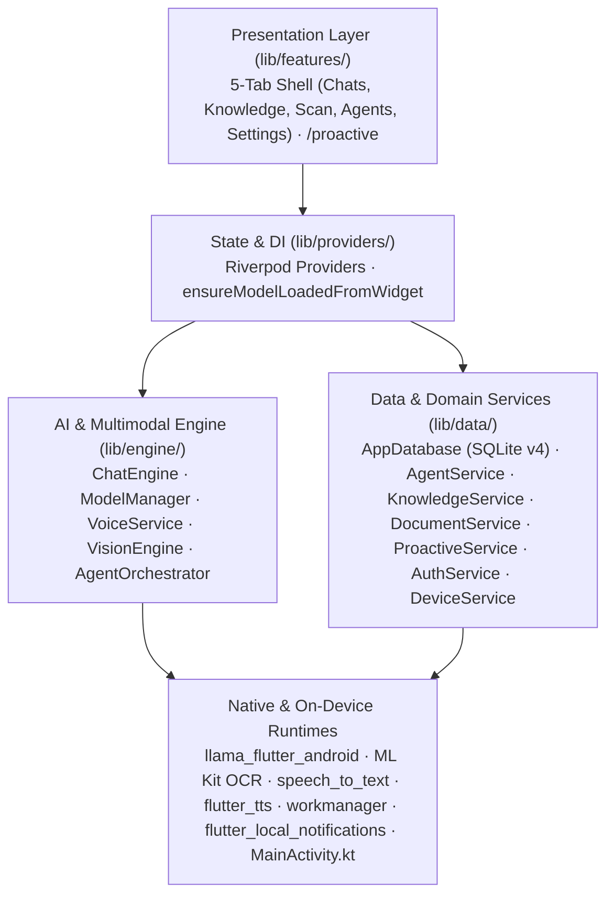
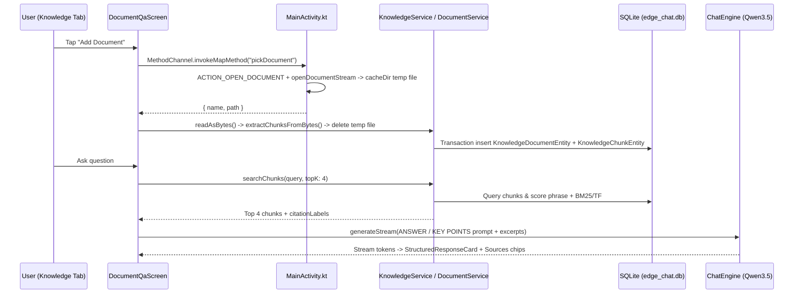

# Software Architecture — Edged (Flutter)

## 1. System Architecture Overview



---

## 2. Layered Module Map

```
lib/
├── main.dart                         # ProviderScope + WidgetsFlutterBinding
├── app.dart                          # GoRouter routes (/loading, /auth/*, /home, /proactive, /models/*)
├── core/
│   ├── theme/                        # AppColors, AppTheme (Material 3 Light & Dark)
│   ├── utils/                        # Formatters (bytes, relative dates, stripMarkdown)
│   └── widgets/                      # EdgedLogo (CustomPainter), StructuredResponseCard
├── engine/
│   ├── models/                       # ModelTier (7 tiers), PromptFormat (ChatML/Gemma/Phi3), ChatModels
│   └── services/
│       ├── chat_engine.dart          # Single-flight mutex, anti-prompt holdback, llama_flutter_android
│       ├── model_manager.dart        # Dio .part Range downloads, WakelockPlus, 99% orphan healing
│       ├── voice_service.dart        # On-device English STT + sentence-buffered TTS + barge-in
│       ├── vision_engine.dart        # Offline ML Kit Latin OCR -> ChatEngine Q&A
│       ├── agent_orchestrator.dart   # Sequential A2A handoffs + RAG/OCR/Email/WhatsApp/Reminder tools
│       └── skills_engine.dart        # 6 classic skill definitions (folded into AgentService)
├── data/
│   ├── database/app_database.dart    # sqflite edge_chat.db (version 4, 10 tables, onUpgrade + onOpen)
│   └── services/
│       ├── agent_service.dart        # 12 predefined Agents + custom SQLite Agents + A2A message logs
│       ├── auth_service.dart         # Phone biometric/PIN App Lock (local_auth) + optional local Profile
│       ├── chat_history_service.dart # Sessions & messages CRUD
│       ├── custom_skills_service.dart# User-authored SQLite skills CRUD
│       ├── document_service.dart     # .txt, .md, .docx, .pdf extraction + overlapping chunker
│       ├── knowledge_service.dart    # Multi-doc RAG indexing + hybrid keyword/BM25 chunk retrieval
│       ├── proactive_service.dart    # Local reminders + Workmanager 24h daily briefing dispatcher
│       └── device_service.dart         # RAM/storage probing + 1.5 GB OS headroom compatibility report
├── providers/                        # Riverpod providers + model_loader_helper.dart
└── features/                         # Splash, Auth, Shell, Chat, Knowledge, Scan, Skills, Proactive, Settings/Models
```

---

## 3. Architecture Decision Records (Design & Library Rationale)

| Decision | Chosen Library / Pattern | Alternatives Rejected | Rationale |
|---|---|---|---|
| **On-Device LLM Runtime** | `llama_flutter_android` + `ChatEngine` mutex | Cloud REST APIs; raw JNI boilerplate | Runs quantized GGUF models (`Qwen3.5`, `Phi-4-mini`, `Gemma 3n`) 100% offline. A `Future`-chain mutex (`_synchronized`) prevents concurrent native inference calls from corrupting context memory. |
| **Offline Voice I/O** | `speech_to_text` (`onDevice: true`) + `flutter_tts` | Bundling `whisper.cpp` / `sherpa_onnx` | Bundling a second `ggml`-based native plugin alongside `llama_flutter_android` risks duplicate `libggml.so` native symbol collisions and significantly increases APK/AAB size. Android's offline `SpeechRecognizer` + `flutter_tts` avoids `.so` conflicts and keeps APK size ~93.7 MB. |
| **Offline Image & Receipt OCR** | `google_mlkit_text_recognition` (`TextRecognitionScript.latin`) | Multimodal `mmproj` pixel vision for all tiers; cloud OCR | Bundled Latin OCR runs in ~200 ms on any phone (including 4 GB RAM devices where `mmproj` is too heavy) and extracts crisp text for `ChatEngine` Q&A. Non-Latin script dependencies remain `compileOnly` and are silenced in `proguard-rules.pro`. |
| **Offline Knowledge Base (RAG)** | `sqflite` + hybrid phrase/BM25 keyword scoring | Heavy native vector DBs / C++ embedding runtimes | Zero extra `.so` binaries, predictable RAM usage, instant indexing, and deterministic `[filename §chunk]` citations across `.txt`, `.md`, `.docx`, and `.pdf`. |
| **Android Document Picking** | `ACTION_OPEN_DOCUMENT` → temp cache file (`MainActivity.kt`) | Returning `ByteArray` over `MethodChannel` | Android's Binder IPC has a hard ~1 MB transaction buffer (`TransactionTooLargeException`). Streaming picked files to `cacheDir` and returning the path handles files up to 10 MB reliably. |
| **Resumable Model Downloads** | `Dio` HTTP `Range` (`.part`) + `WakelockPlus` + lifecycle auto-resume | `FOREGROUND_SERVICE_DATA_SYNC` | Removing `FOREGROUND_SERVICE_DATA_SYNC` avoids Google Play's special-use video review blocker while keeping downloads reliable via `WakelockPlus`, `.part` resume, and automatic restart on `AppLifecycleState.resumed`. |
| **Gallery Image Selection** | `image_picker` (system Photo Picker) without `READ_MEDIA_IMAGES` | Declaring `READ_MEDIA_IMAGES` | Android 13+ Photo Picker grants scoped access to user-selected images without broad gallery permissions, aligning with Google Play's Photo & Video policy. |
| **App Authentication** | `local_auth` (`biometricOnly: false`) + `FlutterFragmentActivity` | Mandatory custom Phone + PIN login screen | Uses the phone's native fingerprint, face unlock, or device PIN by default when a screen lock is set, while skipping gracefully on unlocked test devices—eliminating Play Console's *"Missing sign-in details"* blocker. |
| **Structured UI Output** | `StructuredResponseCard` + plain-text section prompts | Raw `SelectableText` / raw markdown | Small 0.8B–4B quantized models often emit noisy markdown or `<think>` tags. Guiding prompts toward `OVERVIEW` / `SUMMARY` / `DETAILS` / `ANSWER` / `KEY POINTS` + `Formatters.stripMarkdown` produces clean, scannable cards with copy support. |
| **State & Routing** | `flutter_riverpod` + `go_router` | `Bloc` / manual `InheritedWidget` + `Navigator 1.0` | Compile-safe singleton lifecycle management and reactive capability/model state updates across tabs. |

---

## 4. Key Runtime Flows

### 4.1 Offline Knowledge Base Upload & RAG Q&A


### 4.2 Offline Voice Mode with Barge-In
1. User taps mic (`_toggleListening`) → `VoiceService.startListening(onDevice: true)` streams partial & final English transcripts into the composer.
2. When **Speak replies offline** is enabled, `ChatScreen` buffers streamed tokens until sentence boundaries (`.`, `!`, `?`, `\n`) and dispatches each sentence to `VoiceService.speak()`.
3. Tapping **Stop** or **Mic** immediately calls `ChatEngine.stopGeneration()` and `VoiceService.stopSpeaking()` (**barge-in**).

### 4.3 Model Selection & Download Auto-Resume
1. `ModelSelectionScreen` queries `DeviceService.getCompatibilityReport()` (`effectiveRamGb = totalRamGb - 1.5 GB`, `availableStorageBytes - 200 MB`) and highlights a single **`Best for Device`** tier (`0.8B` < 3 GB usable, `2B` 3–5 GB usable, `4B` ≥ 5 GB usable).
2. `ModelDownloadScreen` observes `AppLifecycleState.resumed` and automatically restarts `ModelManager.downloadModel()` from the `.part` file offset if Android interrupted the socket while backgrounded.

---

## 5. Data & Persistence (`lib/data/`)
- **SQLite (`edge_chat.db`, v4)** — guarded by `onCreate`, `onUpgrade`, and `onOpen` (`CREATE TABLE IF NOT EXISTS`):
  - `ChatSessionEntity`, `ChatMessageEntity` (indexed on `SessionId`)
  - `CustomSkillEntity`, `CustomGameEntity`
  - `KnowledgeDocumentEntity`, `KnowledgeChunkEntity` (indexed on `DocumentId`)
  - `ProactiveReminderEntity`
  - `CustomAgentEntity` (`Id`, `Name`, `Description`, `Icon`, `Category`, `SystemPrompt`, `InputPlaceholder`, `Tools`, `NextAgentId`, `CreatedAt`)
  - `AgentRunEntity` (`Id`, `Title`, `CreatedAt`)
  - `AgentMessageEntity` (`Id`, `RunId` indexed, `FromAgent`, `ToAgent`, `Content`, `ActionType`, `ActionPayload`, `CreatedAt`)
- **Secure Storage**: `AuthService` stores `auth_app_lock_enabled`, `profile_name`, `profile_phone`, and `profile_email` locally in `FlutterSecureStorage`.

---

## 6. Non-Functional Requirements (NFRs)

| Category | Requirement | Implementation |
|---|---|---|
| **Privacy & Offline-First** | Zero cloud telemetry; all user data stays local. | Network is used **only** for user-initiated HuggingFace model downloads. Chat, Voice (`onDevice: true`), RAG, ML Kit OCR, and Reminders run 100% locally. |
| **Concurrency & Safety** | Native `llama.cpp` context must never be accessed concurrently. | `ChatEngine` serializes `loadModel`, `unloadModel`, and `generateStream` via a `Future` mutex; UI throttles token repaints to ~80 ms. |
| **Memory & Storage** | Prevent OOM crashes and failed downloads on constrained phones. | Enforces 1.5 GB OS RAM headroom and 200 MB storage buffer; enforces 10 MB max document size; trims chat history to fit model context budget. |
| **Reliability & Resilience** | Recover cleanly from interrupted downloads, crashes, and DB upgrades. | `.part` HTTP Range resume, 99% orphan GGUF metadata healing, `onOpen` table creation, `120s` inference timeout, and `10s` "Still thinking…" indicator. |
| **Platform & Build** | Support modern Android devices & Play Store 16 KB page-size / SDK rules. | Android `minSdk = 26`, `compileSdk = 37`, Java 17 + `desugar_jdk_libs:2.1.5`, 16 KB page-size support, R8 Full Mode with ML Kit/llama keep rules. |
| **Accessibility & UX** | Clean, scannable responses on small screens. | Material 3 Light/Dark themes, `StructuredResponseCard` with copy action, `SafeArea` + scrollable download/error views. |

---

## 7. Technical Risks & Mitigations

| Risk | Impact | Mitigation in Codebase |
|---|---|---|
| **OOM on 4–6 GB RAM phones** | Native `llama.cpp` crash when loading 4B/9B models. | `DeviceService` reserves 1.5 GB OS headroom; `ModelSelectionScreen` dynamically recommends `0.8B` or `2B` as `Best for Device` and warns before oversized downloads. |
| **R8 stripping ML Kit / JNI classes in release builds** | `NullPointerException` (`zzmj.<init>`) in `google_mlkit_text_recognition` or `llama_flutter_android` crashes. | `android/app/proguard-rules.pro` explicitly keeps `com.write4me.llama_flutter_android.**`, `com.google.mlkit.**`, `com.google.android.gms.internal.mlkit_**`, and `com.google.firebase.components.**`, and suppresses unused non-Latin ML Kit warnings. |
| **Android Binder 1 MB limit on document upload** | `PlatformException` / IPC failure when uploading PDFs > 1 MB. | `MainActivity.kt` streams `ACTION_OPEN_DOCUMENT` content to a `cacheDir` temp file and returns only the path; `DocumentQaScreen` reads & deletes the temp file. |
| **Virtual / cloud-backed files in Android picker** | `FileNotFoundException` from `openInputStream(uri)`. | `MainActivity.kt` adds `FLAG_GRANT_READ_URI_PERMISSION`, falls back to `openAssetFileDescriptor` and `openTypedAssetFileDescriptor`, and infers missing extensions from MIME type. |
| **Background network drop during model download** | Connection closes when user switches apps, hiding the Resume button behind long URLs. | `ModelDownloadScreen` puts **Resume / Retry** above a sanitized 4-line error inside `SingleChildScrollView` and auto-resumes via `WidgetsBindingObserver` on `AppLifecycleState.resumed`. |
| **SQLite schema mismatch across app updates** | Missing-table crash on upgrades from v1 builds. | `AppDatabase` executes `CREATE TABLE IF NOT EXISTS` for Knowledge & Proactive tables in both `onUpgrade` and `onOpen`. |
| **Play Store permission policy rejections** | Release blocked by `READ_MEDIA_IMAGES` or `FOREGROUND_SERVICE_DATA_SYNC` video requirements. | `READ_MEDIA_IMAGES` / `READ_MEDIA_VIDEO` removed (`tools:node="remove"`, using Photo Picker) and `FOREGROUND_SERVICE_DATA_SYNC` removed in `1.0.0+4`. |
| **Small-LLM formatting drift or `<think>` leaks** | Raw markdown or reasoning tags shown to users. | `PromptFormat` injects `/no_think` for Qwen3.5, `Formatters.stripMarkdown` strips `<think>` blocks and markdown noise, and `StructuredResponseCard` falls back gracefully to clean plain lines. |
