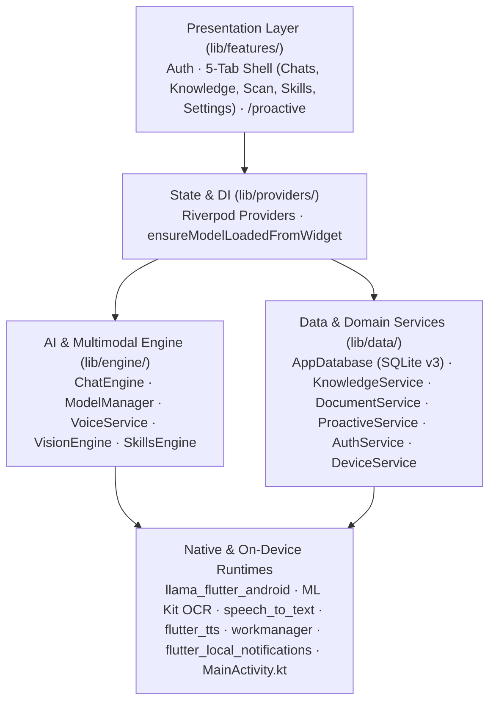

# Software Architecture — Edged (Flutter)

## 1. System Architecture Overview



## 2. Layered Module Map

```
lib/
├── main.dart                         # ProviderScope + WidgetsFlutterBinding
├── app.dart                          # GoRouter routes (/loading, /auth/*, /home, /proactive, /models/*)
├── core/
│   ├── theme/                        # AppColors, AppTheme (Material 3 Light & Dark)
│   ├── utils/                        # Formatters (bytes, relative dates, stripMarkdown)
│   └── widgets/                      # EdgedLogo (CustomPainter), StructuredResponseCard
├── engine/
│   ├── models/                       # ModelTier (7 tiers), PromptFormat (ChatML/Gemma/Phi3), ChatModels
│   └── services/
│       ├── chat_engine.dart          # Single-flight mutex, anti-prompt holdback, llama_flutter_android
│       ├── model_manager.dart        # Dio .part Range downloads, WakelockPlus, 99% orphan healing
│       ├── voice_service.dart        # On-device English STT + sentence-buffered TTS + barge-in
│       ├── vision_engine.dart        # Offline ML Kit Latin OCR -> ChatEngine Q&A
│       └── skills_engine.dart        # 6 built-in offline productivity skills
├── data/
│   ├── database/app_database.dart    # sqflite edge_chat.db (version 3, 7 tables, onUpgrade + onOpen)
│   └── services/
│       ├── auth_service.dart         # 25-country picker, local 6-digit PIN, 30-day secure session
│       ├── chat_history_service.dart # Sessions & messages CRUD
│       ├── custom_skills_service.dart# User-authored SQLite skills CRUD
│       ├── document_service.dart     # .txt, .md, .docx, .pdf extraction + overlapping chunker
│       ├── knowledge_service.dart    # Multi-doc RAG indexing + hybrid keyword/BM25 chunk retrieval
│       ├── proactive_service.dart    # Local reminders + Workmanager 24h daily briefing dispatcher
│       └── device_service.dart         # RAM/storage probing + 1.5 GB OS headroom compatibility report
├── providers/                        # Riverpod providers + model_loader_helper.dart
└── features/                         # Splash, Auth, Shell, Chat, Knowledge, Scan, Skills, Proactive, Settings/Models
```

## 3. Engine Layer (`lib/engine/`)
- **`ModelTier`**: Single source of truth for all 7 GGUF tiers (`qwen35-0.8b`, `qwen35-2b`, `phi4-mini`, `gemma3n-e2b`, `qwen35-4b`, `gemma3n-e4b`, `qwen35-9b`), HuggingFace URLs, byte sizes, RAM requirements, context limits, `PromptFormat`, and `/no_think` suppression flags.
- **`PromptFormat`**: Formats `ChatML` (`<|im_start|>/<|im_end|>`), `Gemma` (`<start_of_turn>/<end_of_turn>`), and `Phi3` (`<|system|>/<|end|>`), and supplies per-family anti-prompts.
- **`ChatEngine`**: Serializes load, unload, and generation via a `Future` mutex (`_synchronized`). Streams tokens through an anti-prompt holdback buffer so partial stop tokens are never emitted. Uses `llama_flutter_android` (`llama.cpp`) on Android with an offline deterministic preview fallback when no native backend is linked.
- **`ModelManager`**: Streams downloads via `Dio` to `<appDocs>/models/`, supports HTTP `Range` `.part` resume, holds `WakelockPlus`, writes `prompter_model_meta.json`, and self-heals lost metadata if a GGUF file exists at `>= 99%` of expected size. `ModelDownloadScreen` observes `AppLifecycleState.resumed` to auto-resume interrupted background downloads.
- **`VoiceService`**: Wraps `speech_to_text` (`onDevice: true`, `en_US`) and `flutter_tts` for hands-free chat with sentence-buffered streaming TTS and instant barge-in cancellation on Stop or mic tap.
- **`VisionEngine`**: Uses `google_mlkit_text_recognition` (`TextRecognizer(script: TextRecognitionScript.latin)`) to extract text offline from camera or Photo Picker images, then streams structured `SUMMARY` / `DETAILS` answers via `ChatEngine`.

## 4. Offline RAG, Proactive & Persistence (`lib/data/`)
- **Offline Knowledge Base (RAG + Citations)**:
  1. On Android, `MainActivity.kt` (`pickDocument`) launches `ACTION_OPEN_DOCUMENT` with `FLAG_GRANT_READ_URI_PERMISSION`, falls back across `openInputStream` / `openAssetFileDescriptor` / `openTypedAssetFileDescriptor`, infers missing extensions from MIME type, and streams up to 10 MB to a temporary cache file (avoiding Android's 1 MB Binder transaction limit).
  2. `DocumentService` extracts text (`.txt`, `.md`, `.docx` via `archive` + `xml`, `.pdf` via `syncfusion_flutter_pdf`) and splits it into overlapping ~1,100-char chunks.
  3. `KnowledgeService` persists documents and chunks in SQLite and scores chunks using phrase + keyword/BM25 matching, returning `[filename §chunk]` citations rendered inside `StructuredResponseCard`.
- **Proactive Assistant (`/proactive`)**:
  - `ProactiveService` initializes `flutter_local_notifications` and `workmanager` (`edgedWorkmanagerDispatcher`), schedules local reminders, and registers optional 24-hour periodic briefing tasks.
  - `ProactiveScreen` builds a structured Daily Briefing (`OVERVIEW`, `HIGHLIGHTS`, `NEXT ACTIONS`) from recent chats, indexed Knowledge docs, and pending reminders.
- **SQLite (`edge_chat.db`, v3)** — guarded by both `onUpgrade` and `onOpen`:
  - `ChatSessionEntity` (`Id`, `Title`, `CreatedAt`, `UpdatedAt`, `Summary`, `SummarizedUpToMessageId`)
  - `ChatMessageEntity` (`Id`, `SessionId` indexed, `Role`, `Content`, `Timestamp`)
  - `CustomSkillEntity` (`Id`, `Name`, `Description`, `Icon`, `SystemPrompt`, `InputPlaceholder`, `Category`, `CreatedAt`)
  - `CustomGameEntity` (`Id`, `Name`, `Description`, `Icon`, `Category`, `SystemPrompt`, `StarterMessage`, `HowToPlay`, `CreatedAt`)
  - `KnowledgeDocumentEntity` (`Id`, `FileName`, `FileSizeBytes`, `ChunkCount`, `CreatedAt`)
  - `KnowledgeChunkEntity` (`Id`, `DocumentId` indexed, `FileName`, `ChunkIndex`, `Content`)
  - `ProactiveReminderEntity` (`Id`, `Title`, `TriggerAt`, `IsCompleted`, `CreatedAt`)
- **Secure Storage**: `AuthService` stores `auth_phone`, `auth_otp`, `auth_token`, and `auth_expiry` in `FlutterSecureStorage`.

## 5. Native Channels, Build & Navigation Flow
- **Native Device Channel (`com.edgedai.app/device`)**:
  - Android ([MainActivity.kt](file:///d:/Sambeet/Working%20Folder/edge-app-v2/android/app/src/main/kotlin/com/edgedai/app/MainActivity.kt)): `ActivityManager.MemoryInfo.totalMem`, `StatFs.availableBytes`, `POST_NOTIFICATIONS` permission request, and `pickDocument`.
  - iOS ([AppDelegate.swift](file:///d:/Sambeet/Working%20Folder/edge-app-v2/ios/Runner/AppDelegate.swift)): `ProcessInfo.processInfo.physicalMemory` and `volumeAvailableCapacityForImportantUsage`.
- **Android Build & Play Store Compliance**:
  - `minSdk = 26`, `compileSdk = 37`, Java 17 + `desugar_jdk_libs:2.1.5` (required by `flutter_local_notifications`).
  - R8 ProGuard rules (`android/app/proguard-rules.pro`) keep `llama_flutter_android`, `com.google.mlkit.**`, `com.google.android.gms.internal.mlkit_**`, and `com.google.firebase.components.**` while suppressing optional non-Latin ML Kit script warnings.
  - `READ_MEDIA_IMAGES` / `READ_MEDIA_VIDEO` are stripped via `tools:node="remove"` (using Android's system Photo Picker instead).
- **Navigation & State Flow**:
  - `/loading` (`LoadingScreen`) checks `AuthService.isAuthenticated()` → `/auth/phone` or `/home` (`MainShellScreen`).
  - `MainShellScreen` presents 5 tabs (`Chats`, `Knowledge`, `Scan`, `Skills`, `Settings`), with `ModelSelectionScreen` computing a device-aware **`Best for Device`** recommendation and `ensureModelLoadedFromWidget(ref)` centralizing model loading across all AI screens.
